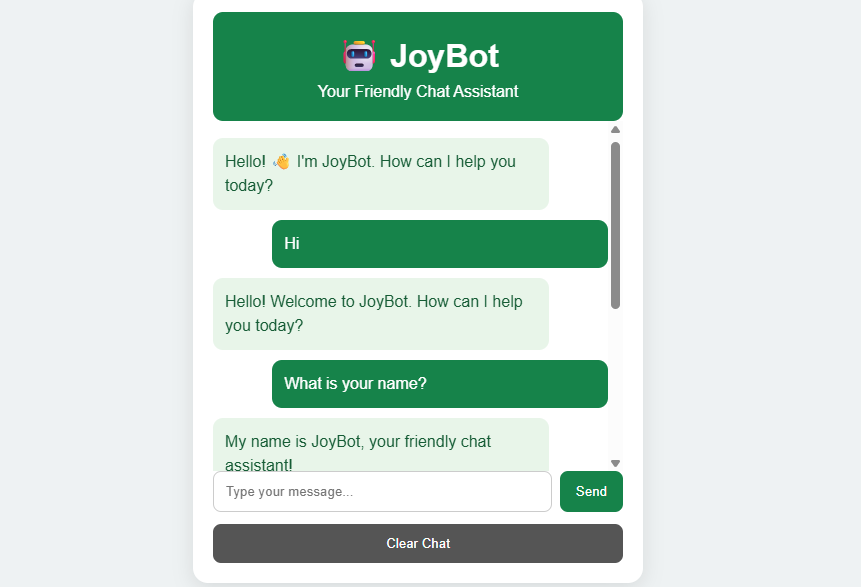

# 🤖 JoyBot — Your Friendly Chat Assistant

## About the Project

JoyBot is a simple rule-based chatbot built using HTML, CSS, JavaScript, and Python. It allows users to send messages and receive automated responses.

## Technologies Used

- HTML — webpage structure
- CSS — webpage styling
- JavaScript — chat functionality
- Python — chatbot logic
- Flask — Python web framework

## Features

- Interactive chat interface
- Automated responses to common questions
- Greeting and farewell messages
- Clear Chat button
- Responsive layout

## How to Run the Project

1. Install Python.
2. Install Flask using `pip install flask`.
3. Open the project folder in VS Code.
4. Run `python app.py`.
5. Open the forwarded port 5000 in Codespaces.

## What I Learned

I practised creating a webpage, styling an interface, handling user interactions with JavaScript, and connecting a frontend to a Python backend using Flask.

**Created by:** Joy Gundu

**Student ID:** T4Y-C2-014

**Programme:** Tech4Youth Cohort 2

**Project:** Week 03 Homework

## Project Screenshot

